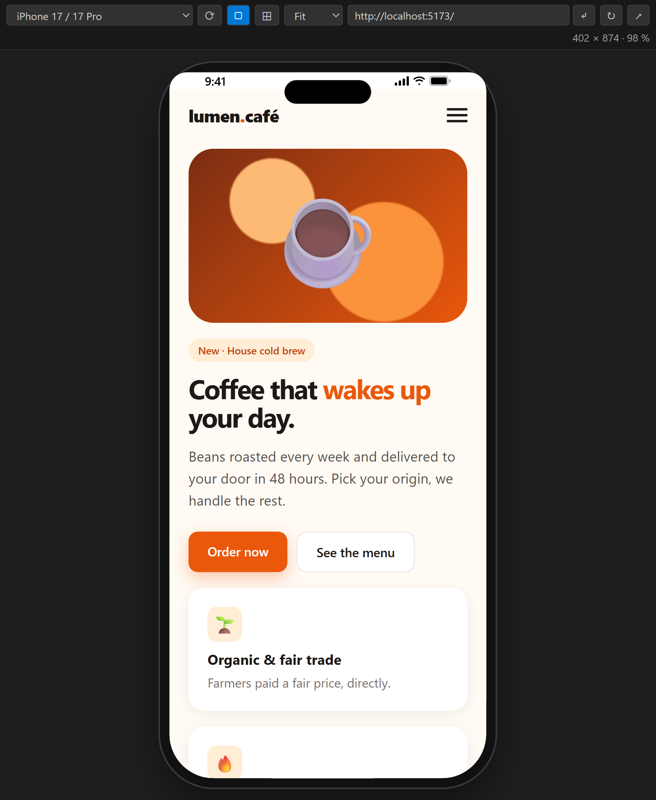
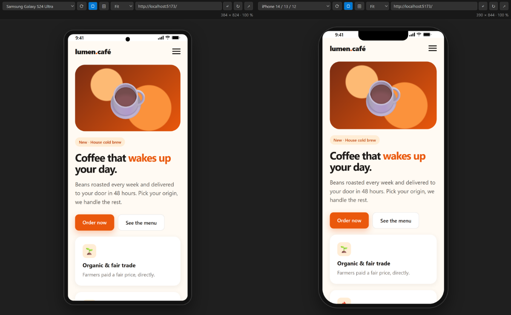

# Device Frame Preview

**Prévisualise ton site dans des cadres réalistes de téléphone, tablette, PC portable ou écran, directement dans VS Code.**

🇬🇧 [English version](README.md)

## Démarrage en 1 clic

Clique sur **Preview** dans la barre d'état (en bas à droite) ou appuie sur **`Ctrl+Alt+P`** (`Cmd+Alt+P` sur Mac) :

- **un fichier HTML est ouvert** → il s'affiche, avec rechargement live à chaque enregistrement ;
- **sinon** → l'extension **détecte automatiquement ton serveur de dev** (Vite, Next.js, Angular, Django, Laravel, PHP, Flask…) et l'affiche. S'il y en a plusieurs, elle te demande lequel.

Tu peux aussi faire un clic droit sur un fichier `.html` → *Prévisualiser ce fichier HTML*.

## Fonctionnalités

- **71 appareils** : iPhone (du 5 au 17 Pro Max), Pixel, Galaxy, Xiaomi, OnePlus, pliables (Z Fold, Z Flip, Pixel Fold), iPad, Galaxy Tab, Surface, MacBook, PC portables et écrans jusqu'à l'ultra-large.
- **Cadres réalistes** : Dynamic Island, encoche ou poinçon selon le modèle, barre d'état, cadre de PC portable ou d'écran de bureau.
- **Mode multi-appareils** (⊞) : téléphone, tablette et ordinateur côte à côte, avec **navigation synchronisée**.
- **Rechargement live** des fichiers HTML : le CSS s'applique sans recharger, la position de défilement est conservée, les modifications faites hors de VS Code sont détectées.
- **Rotation**, **zoom**, cadre affichable ou masquable, **taille personnalisée** et appareils personnalisés.
- **Serveur arrêté ?** Un message s'affiche et l'aperçu se recharge tout seul dès que ton serveur redémarre.
- L'aperçu est **restauré** au redémarrage de VS Code.
- Disponible en **français** et en **anglais** (suit la langue de VS Code).

Raccourcis dans l'aperçu : `R` pivoter · `F` cadre · `M` multi-appareils.

| iPhone 17 Pro | Galaxy S24 Ultra et iPhone 14 |
|---|---|
|  |  |

## Réglages

| Réglage | Par défaut | Rôle |
|---|---|---|
| `devicePreview.defaultUrl` | `http://localhost:3000` | URL utilisée si aucun serveur n'est détecté |
| `devicePreview.defaultDevice` | `iphone-15` | Appareil à la première ouverture |
| `devicePreview.multiDevices` | `["iphone-15", "ipad-air", "laptop-13"]` | Appareils du mode multi |
| `devicePreview.customDevices` | `[]` | Appareils perso, ex. `[{ "name": "Mon tel", "width": 390, "height": 844 }]` |
| `devicePreview.autoReload` | `true` | Rechargement live en mode fichier HTML |
| `devicePreview.proxy` | `true` | Proxy local (voir ci-dessous) |
| `devicePreview.showStatusBar` | `true` | Bouton « Preview » dans la barre d'état |

## Confidentialité et sécurité

Beaucoup de frameworks (Django, Rails…) interdisent l'affichage de leurs pages dans un cadre (`X-Frame-Options`, `frame-ancestors`), ce qui donnerait un aperçu blanc. Pour l'éviter, l'extension fait passer les pages par un **petit proxy local** qui retire uniquement ces deux en-têtes.

- Le proxy écoute **uniquement sur ta machine** (`127.0.0.1`), jamais sur le réseau.
- Il ne sert qu'à l'aperçu dans VS Code : ton site, ton code et ta configuration ne sont **pas modifiés**.
- Il s'arrête quand tu fermes l'aperçu.
- **Aucune donnée n'est envoyée** à l'extérieur ; l'extension ne collecte rien.

Tu peux le désactiver avec `"devicePreview.proxy": false`.

## Limites connues

- Les tailles correspondent au **viewport** (pixels CSS) des appareils ; le moteur de rendu reste celui de VS Code (Chromium), pas Safari iOS.
- Le *user-agent* n'est pas modifié : les sites qui détectent le mobile côté serveur afficheront leur version ordinateur.

## Un avis, un bug ?

Un bug ou un appareil à ajouter ? [Ouvre une issue](https://github.com/CocoCrypt/Device-Frame-Preview/issues).

## Licence

MIT
