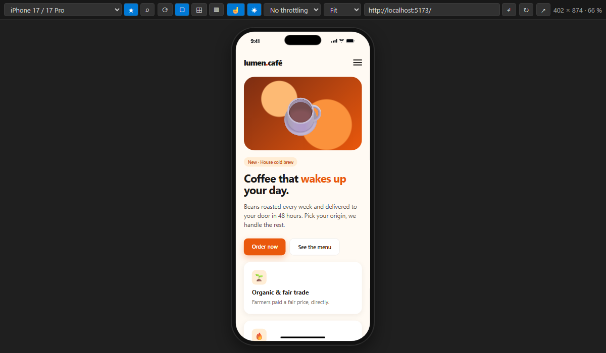
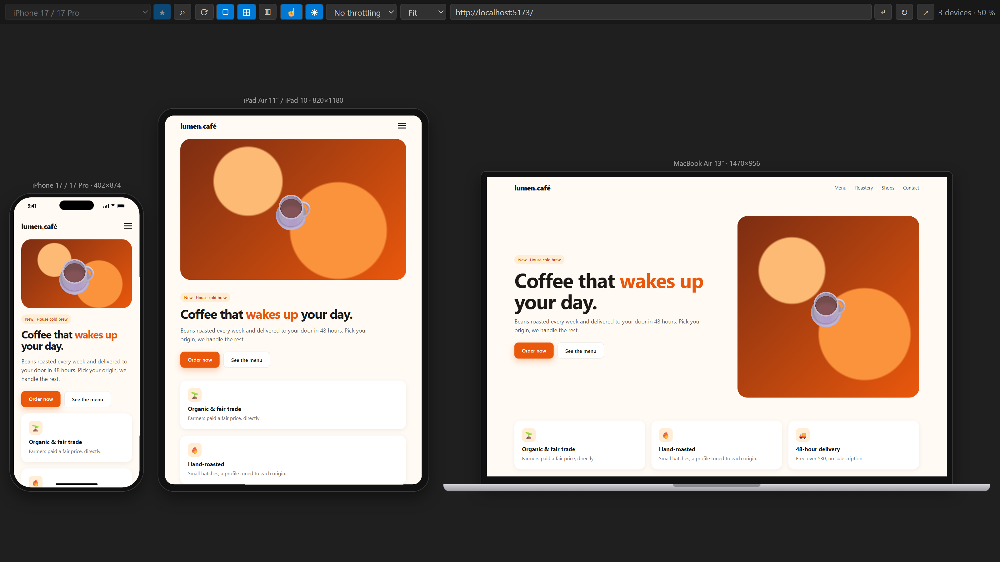
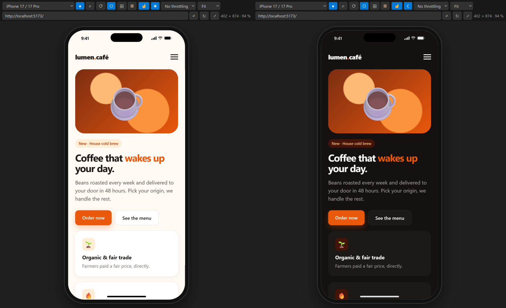
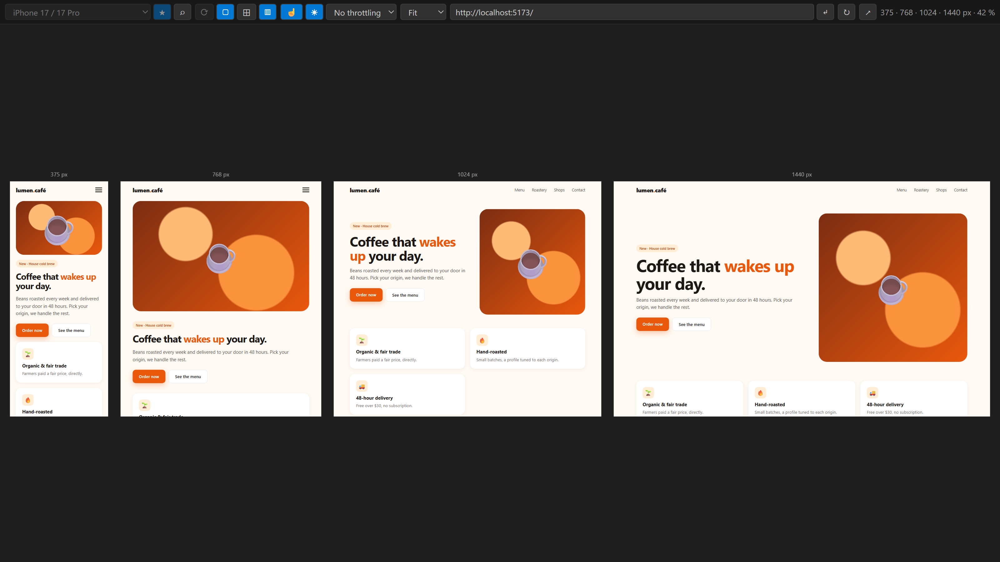

# Device Frame Preview

**Prévisualise ton site dans des cadres réalistes de téléphone, tablette, PC portable ou écran, directement dans VS Code.**

🇬🇧 [English version](README.md)

## Démarrage en 1 clic

Clique sur **Preview** dans la barre d'état (en bas à droite) ou appuie sur **`Ctrl+Alt+P`** (`Cmd+Alt+P` sur Mac) :

- **un fichier HTML est ouvert** → il s'affiche, avec rechargement live à chaque enregistrement ;
- **sinon** → l'extension **détecte automatiquement ton serveur de dev** (Vite, Next.js, Angular, Django, Laravel, PHP, Flask…) et l'affiche. S'il y en a plusieurs, elle te demande lequel.

Tu peux aussi faire un clic droit sur un fichier `.html` → *Prévisualiser ce fichier HTML*.

## Fonctionnalités

- **71 appareils** : iPhone (du 5 au 17 Pro Max), Pixel, Galaxy, Xiaomi, OnePlus, pliables (Z Fold, Z Flip, Pixel Fold), iPad, Galaxy Tab, Surface, MacBook, PC portables et écrans jusqu'à l'ultra-large.
- **Cadres réalistes** : Dynamic Island, encoche ou poinçon selon le modèle, barre d'état, cadre de PC portable ou d'écran de bureau.
- **Mode multi-appareils** (⊞) : téléphone, tablette et ordinateur côte à côte, avec **navigation et défilement synchronisés**.
- **Mode points de rupture** (▥) : plusieurs largeurs sans cadre côte à côte (320, 768, 1024 et 1440 px par défaut) pour vérifier tes media queries d'un coup d'œil.
- **Vraie identité de l'appareil** : chaque appareil présente son propre **user-agent** (iPhone, Android, iPad), à ton JavaScript comme à ton serveur. Les sites qui détectent le mobile côté serveur affichent donc leur version mobile.
- **Émulation tactile** (☝) : la souris devient un doigt. Les événements tactiles sont émis, on **fait défiler en glissant** (avec inertie), et `(pointer: coarse)` / `(hover: none)` sont vrais.
- **Mode clair / sombre** (◐) : force `prefers-color-scheme` en clair ou en sombre sans toucher à ton système. Le changement est instantané, sans rechargement.
- **Réseau lent** simulé : 4G rapide, 4G lente ou 3G (latence + débit, préréglages des DevTools de Chrome).
- **Zones sûres** : sur les iPhone à encoche ou Dynamic Island, les pages en `viewport-fit=cover` passent sous la barre d'état et `env(safe-area-inset-*)` prend les vraies valeurs.
- **Rechargement live** des fichiers HTML : le CSS s'applique sans recharger, la position de défilement est conservée, les modifications faites hors de VS Code sont détectées.
- **Trouver un appareil vite** : recherche par nom ou par largeur (⌕ ou `/`), ★ favoris et appareils récents en tête de liste.
- **Rotation**, **zoom**, cadre affichable ou masquable, **taille personnalisée** avec règles et **poignées de redimensionnement** à la souris, et appareils personnalisés.
- **Serveur arrêté ?** Un message s'affiche et l'aperçu se recharge tout seul dès que ton serveur redémarre.
- Fonctionne en **Remote SSH, WSL, Dev Containers et Codespaces** (les ports sont redirigés automatiquement).
- L'aperçu est **restauré** au redémarrage de VS Code.
- Disponible en **français** et en **anglais** (suit la langue de VS Code).

Raccourcis dans l'aperçu : `R` pivoter · `F` cadre · `M` multi-appareils · `B` points de rupture · `T` tactile · `D` clair/sombre · `/` chercher un appareil · `*` favori.

**Mode clair / sombre**, avec la page qui passe sous la Dynamic Island (`viewport-fit=cover` et zones sûres) :

**Mode points de rupture** : plusieurs largeurs côte à côte, sans cadre :

## Réglages

| Réglage | Par défaut | Rôle |
|---|---|---|
| `devicePreview.defaultUrl` | `http://localhost:3000` | URL utilisée si aucun serveur n'est détecté |
| `devicePreview.defaultDevice` | `iphone-15` | Appareil à la première ouverture |
| `devicePreview.multiDevices` | `["iphone-15", "ipad-air", "laptop-13"]` | Appareils du mode multi |
| `devicePreview.breakpoints` | `[320, 768, 1024, 1440]` | Largeurs du mode points de rupture |
| `devicePreview.customDevices` | `[]` | Appareils perso, ex. `[{ "name": "Mon tel", "width": 390, "height": 844, "userAgent": "ios" }]` |
| `devicePreview.emulateUserAgent` | `true` | Présente au site le user-agent de chaque appareil |
| `devicePreview.syncScroll` | `true` | Défilement synchronisé entre les appareils |
| `devicePreview.autoReload` | `true` | Rechargement live en mode fichier HTML |
| `devicePreview.proxy` | `true` | Proxy local (voir ci-dessous) |
| `devicePreview.showStatusBar` | `true` | Bouton « Preview » dans la barre d'état |

## Confidentialité et sécurité

Beaucoup de frameworks (Django, Rails…) interdisent l'affichage de leurs pages dans un cadre (`X-Frame-Options`, `frame-ancestors`), ce qui donnerait un aperçu blanc. Pour l'éviter, l'extension fait passer les pages par un **petit proxy local** qui retire uniquement ces deux en-têtes. Le proxy présente aussi le user-agent de l'appareil, applique la vitesse de réseau simulée et ajoute un petit script aux pages affichées (émulation de l'appareil, rechargement live).

- Le proxy écoute **uniquement sur ta machine** (`127.0.0.1`), jamais sur le réseau.
- Il ne sert qu'à l'aperçu dans VS Code : ton site, ton code et ta configuration ne sont **pas modifiés**.
- Il s'arrête quand tu fermes l'aperçu.
- **Aucune donnée n'est envoyée** à l'extérieur ; l'extension ne collecte rien.

Tu peux le désactiver avec `"devicePreview.proxy": false`.

## Limites connues

- Les tailles correspondent au **viewport** (pixels CSS) des appareils ; le moteur de rendu reste celui de VS Code (Chromium), pas Safari iOS.
- Les iPad se présentent comme un Mac, exactement comme Safari sur iPadOS : un site qui détecte le mobile **côté serveur** y affiche sa version ordinateur, comme sur un vrai iPad. Ton JavaScript peut quand même reconnaître un iPad (`navigator.maxTouchPoints` vaut 5).
- L'émulation (user-agent, tactile, clair/sombre, zones sûres) suppose que la page passe par l'extension : mode fichier HTML ou proxy local. Avec `"devicePreview.proxy": false`, le serveur voit le user-agent de VS Code.
- Les feuilles de style chargées depuis un autre domaine (CDN) ne peuvent pas être adaptées (clair/sombre, media queries tactiles, zones sûres). La pseudo-classe CSS `:hover` réagit toujours à la souris.
- La vitesse de réseau simulée s'applique au site prévisualisé, pas aux ressources chargées directement depuis d'autres domaines.

## Un avis, un bug ?

Un bug ou un appareil à ajouter ? [Ouvre une issue](https://github.com/CocoCrypt/Device-Frame-Preview/issues).

## Licence

MIT
