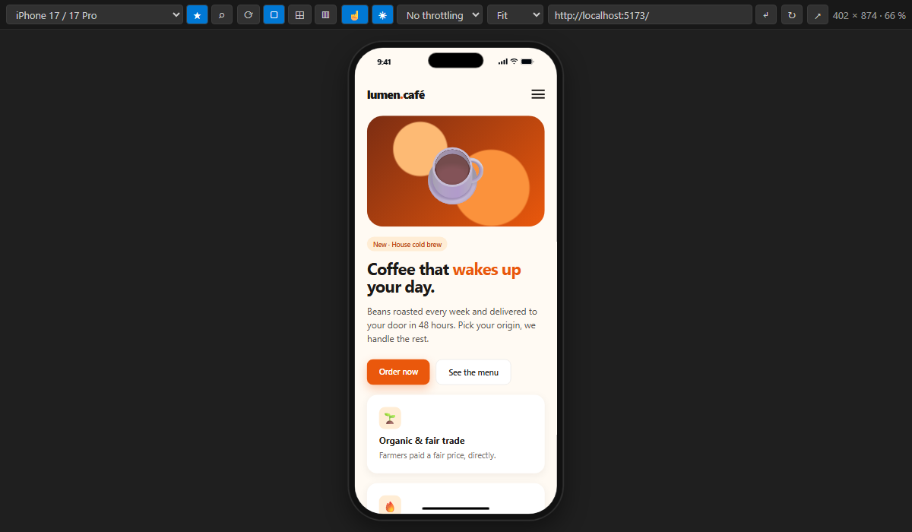
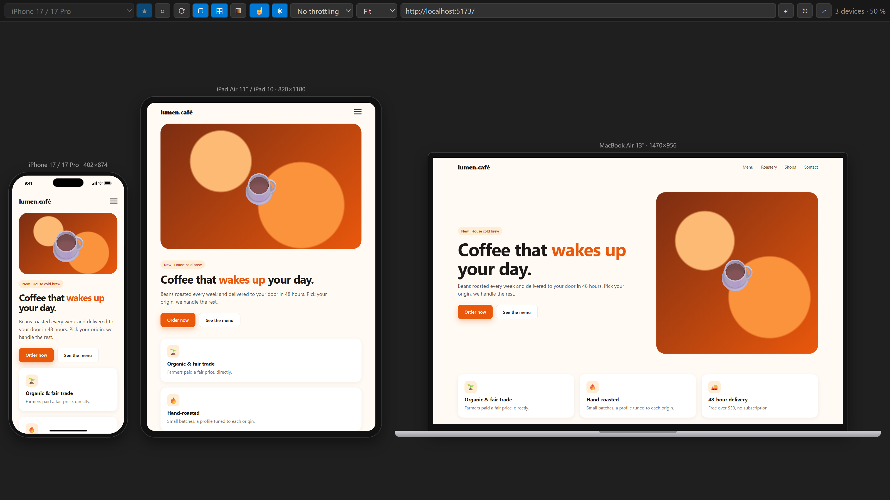
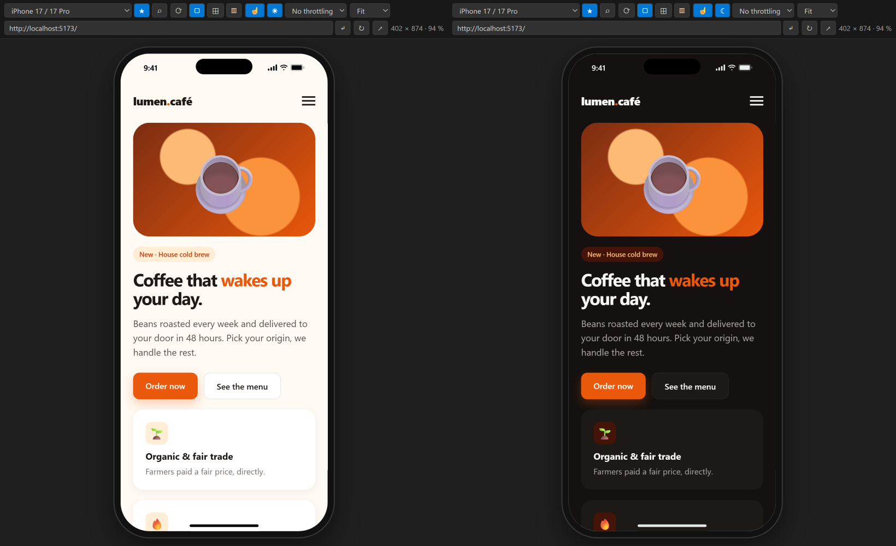
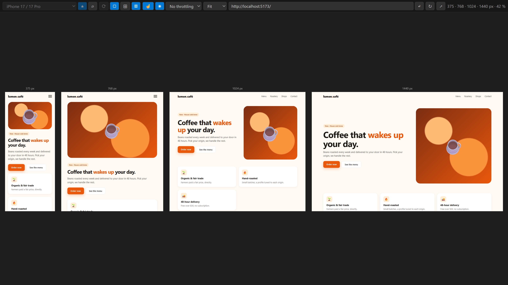

# Device Frame Preview

**Preview your website inside realistic phone, tablet, laptop and monitor frames — right in VS Code.**

🇫🇷 [Version française](README.fr.md)

## One-click start

Click **Preview** in the status bar (bottom right) or press **`Ctrl+Alt+P`** (`Cmd+Alt+P` on Mac):

- **an HTML file is open** → it is previewed, with live reload on every save;
- **otherwise** → the extension **automatically detects your running dev server** (Vite, Next.js, Angular, Django, Laravel, PHP, Flask…) and shows it. If several are running, it asks which one.

You can also right-click an `.html` file → *Preview this HTML file*.

## Features

- **71 devices**: iPhone (5 to 17 Pro Max), Pixel, Galaxy, Xiaomi, OnePlus, foldables (Z Fold, Z Flip, Pixel Fold), iPad, Galaxy Tab, Surface, MacBook, laptops and monitors up to ultrawide.
- **Realistic frames**: Dynamic Island, notch or punch-hole depending on the model, status bar, laptop and desktop monitor frames.
- **Multi-device view** (⊞): phone, tablet and computer side by side, with **synchronized navigation and scrolling**.
- **Breakpoints view** (▥): frameless widths side by side (320, 768, 1024, 1440 px by default) to check your media queries at a glance.
- **Real device identity**: each device presents its own **user-agent** (iPhone, Android, iPad), both to your JavaScript and to your server, so sites that detect mobile on the server side show their mobile version.
- **Touch emulation** (☝): the mouse acts as a finger. Touch events are fired, you **drag to scroll** (with inertia), and `(pointer: coarse)` / `(hover: none)` match.
- **Light / dark mode** (◐): force `prefers-color-scheme` to light or dark without touching your OS. It's applied instantly, without reloading.
- **Slow network** simulation: Fast 4G, Slow 4G or 3G (latency + bandwidth, Chrome DevTools presets).
- **Safe areas**: on iPhones with a notch or Dynamic Island, pages using `viewport-fit=cover` extend under the status bar and `env(safe-area-inset-*)` gets the real values.
- **Live reload** for HTML files: CSS is applied without reloading, scroll position is kept, changes made outside VS Code are detected.
- **Find a device fast**: search by name or width (⌕ or `/`), ★ favorites and recent devices at the top of the list.
- **Rotate**, **zoom**, show/hide frame, **custom size** with rulers and **drag-to-resize** handles, and your own custom devices.
- **Server stopped?** A message is shown and the preview reloads automatically as soon as your server is back.
- Works with **Remote SSH, WSL, Dev Containers and Codespaces** (ports are forwarded automatically).
- The preview is **restored** when VS Code restarts.
- Available in **English** and **French** (follows your VS Code language).

Shortcuts inside the preview: `R` rotate · `F` frame · `M` multi-device · `B` breakpoints · `T` touch · `D` light/dark · `/` search a device · `*` favorite.

**Light / dark mode**, with the page extending under the Dynamic Island (`viewport-fit=cover` and safe areas):

**Breakpoints view**: several widths side by side, without frames:

## Settings

| Setting | Default | Purpose |
|---|---|---|
| `devicePreview.defaultUrl` | `http://localhost:3000` | URL used when no server is detected |
| `devicePreview.defaultDevice` | `iphone-15` | Device used the first time |
| `devicePreview.multiDevices` | `["iphone-15", "ipad-air", "laptop-13"]` | Devices shown in multi-device view |
| `devicePreview.breakpoints` | `[320, 768, 1024, 1440]` | Widths shown in breakpoints view |
| `devicePreview.customDevices` | `[]` | Your own devices, e.g. `[{ "name": "My phone", "width": 390, "height": 844, "radius": 48, "notch": "punch", "userAgent": "android" }]` (`notch`: `island`, `notch` or `punch`) |
| `devicePreview.emulateUserAgent` | `true` | Present each device's user-agent to the site |
| `devicePreview.syncScroll` | `true` | Synchronized scrolling between devices |
| `devicePreview.autoReload` | `true` | Live reload in HTML file mode |
| `devicePreview.proxy` | `true` | Local proxy (see below) |
| `devicePreview.showStatusBar` | `true` | “Preview” button in the status bar |

## Privacy & security

Many frameworks (Django, Rails…) forbid their pages from being displayed in a frame (`X-Frame-Options`, `frame-ancestors`), which would give a blank preview. To avoid that, the extension routes pages through a **small local proxy** that removes only those two headers. The proxy also sets the device's user-agent, applies the simulated network speed, and adds a small script to the previewed pages (device emulation, live reload).

- The proxy listens **only on your machine** (`127.0.0.1`), never on the network.
- It is only used for the preview inside VS Code: your site, code and configuration are **not modified**.
- It stops when you close the preview.
- **No data is sent anywhere**; the extension collects nothing.

You can turn it off with `"devicePreview.proxy": false`.

## Known limitations

- Sizes match each device's **viewport** (CSS pixels); rendering is done by VS Code's engine (Chromium), not iOS Safari.
- iPads present themselves as a Mac, exactly like Safari on iPadOS: a site that detects mobile **on the server** shows its desktop version there, as on a real iPad. Your JavaScript can still tell it's an iPad (`navigator.maxTouchPoints` is 5).
- Emulation (user-agent, touch, light/dark, safe areas) needs the page to go through the extension: HTML file mode or the local proxy. With `"devicePreview.proxy": false`, the server sees VS Code's user-agent.
- Stylesheets loaded from another domain (CDN) can't be adapted for light/dark, touch media queries or safe areas. The CSS `:hover` pseudo-class still reacts to the mouse.
- Simulated network speed applies to the previewed site, not to resources loaded directly from other domains.

## Feedback

Found a bug or want a device added? [Open an issue](https://github.com/CocoCrypt/Device-Frame-Preview/issues).

## License

MIT
